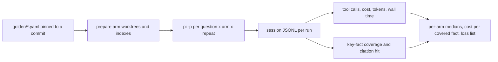

# Agent evals

Does giving a coding agent Smritikosh make it cheaper, faster and more correct
than the alternatives? This harness answers that by running the
[pi coding agent](https://github.com/badlogic/pi-mono) on Smritikosh's own
source under four context arms, then comparing tool calls, cost, tokens, wall
time and answer correctness per question.

The goal is not a headline number. It is a per-question loss list that says
where Smritikosh is beaten and by what, so the next retrieval change has a
target.

## Arms

Model, tool allowlist, thinking level and question are fixed. Only the
retrieval context changes, following the "toggle only the index" framing in
[_Code Isn't Memory_](https://arxiv.org/abs/2606.22417).

| Arm | Context appended to the system prompt | Index on disk |
| --- | --- | --- |
| `baseline` | base `CLAUDE.md` only | none |
| `smritikosh` | base + Smritikosh usage rule (facet search, then `explore chunks --range`) | `smritikosh.duckdb` |
| `graphify` | base + graphify guidance (`graphify query` / `path` / `explain`) | `graphify-out/`, built AST-only, so no LLM credits |
| `both` | base + both blocks | both |

Every arm gets the same base `CLAUDE.md` (a short project overview), so the
baseline is "a well-documented repo with no retrieval tool", not "nothing".

## Isolation

- Each arm runs in its own `git worktree` at the golden set's `commit`. That
  commit predates `evals/`, so gold answers cannot leak into an index or a grep.
  `plan/` is gitignored and therefore absent too.
- pi runs with nothing discovered implicitly, so global `~/.pi` context,
  extensions, skills and MCP servers stay out:

  ```bash
  pi -p --mode json \
    --session-dir runs/<run_id> \
    --no-extensions --no-skills --no-prompt-templates --no-context-files \
    --append-system-prompt arms/<arm>/context.md \
    --tools read,bash,grep,find,ls \
    --provider anthropic --model <sonnet-class> --thinking low \
    "<question>"
  ```

  Confirm the built-in tool names against `pi --help` during the pilot.
- Index build time and cost are recorded once per arm as setup, kept separate
  from per-question numbers.
- Run order is randomized across arms so provider-side caching and latency
  drift don't favour one arm.

## What gets measured

pi's session JSONL already holds everything: `toolCall` entries, per-message
`usage` (`input`, `output`, `cacheRead`, `cacheWrite`, `cost.total`) and
`timestamp`s. Nothing needs instrumenting, only parsing.

- **Efficiency:** total cost, fresh vs. cached tokens, tool calls by kind
  (smritikosh, graphify, read, grep/find, other), turns, and wall time (first to
  last timestamp, cross-checked against the subprocess clock).
- **Correctness:** key-fact coverage, using
  `coverage = (covered + 0.5 * partial) / total` (borrowed from graphify's
  harness). The judge is a fixed cheap model, separate from the agent, and must
  quote the answer verbatim for every verdict so grades can be audited.
- **Citation hit:** deterministic. Does any `PATH:START-END` in the answer
  overlap a gold range?
- **Derived:** cost per covered fact, and success
  (`coverage >= 0.8` and a citation hit).



## Golden set

[`golden/smritikosh.yaml`](golden/smritikosh.yaml) holds 8 pilot questions
across seven categories: locate, config, explain_flow, impact, cross_file,
docs_and_code and negative. Questions avoid exact symbol names where possible,
so grep doesn't get a free hit. q03 and q05 need cross-file tracing, which is
graphify's strength. They are the questions most likely to expose Smritikosh
gaps, which is why they are in the set. q08 asks about an unsupported language,
so the right answer is "not supported", not a hallucinated one.

## Report

`results/<date>/report.md` plus `runs.csv`:

- per-arm median and IQR for cost, wall time, tool calls, tokens, coverage and
  success rate
- per-question wins and losses of `smritikosh` against every other arm
- **Smritikosh losses:** for each question it lost on correctness or cost, the
  queries the agent issued, the ranges it got back, and what the winning arm
  read instead. This is the improvement backlog.

## Plan

- [x] Pilot golden set (8 questions, verified against `7b34092`)
- [ ] `arms/base_CLAUDE.md` and `arms/{baseline,smritikosh,graphify,both}/context.md`
- [ ] `prepare.py`: worktrees at `commit`, then `smritikosh index .` /
      `graphify update .` per arm, recording build time and cost
- [ ] `run.py`: question x arm x repeat matrix, randomized order, resumable,
      `--max-spend`
- [ ] `metrics.py`: session JSONL to one row per run
- [ ] `grade.py`: judge coverage with quotes, plus citation overlap
- [ ] `report.py`: aggregates and the loss list
- [ ] `make eval-pilot`
- [ ] Pilot: 8 questions x 4 arms x 1 repeat (32 runs). Check that `baseline`
      never touches an index, that tool names match, and that grades are stable
      across two judge passes
- [ ] Scale to about 20 questions x 3 repeats, reporting per-question medians
