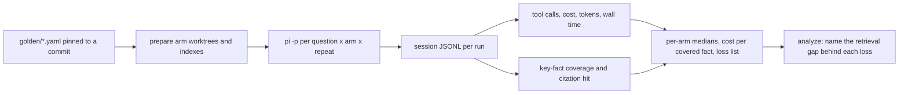

# Agent evals

Does giving a coding agent Smritikosh make it cheaper, faster and more correct
than the alternatives? This harness answers that by running the
[pi coding agent](https://github.com/badlogic/pi-mono) on Smritikosh's own
source under several context arms, then comparing tool calls, cost, tokens,
wall time and answer correctness per question.

The goal is not a headline number. It is a per-question loss list that says
where Smritikosh is beaten and by what, so the next retrieval change has a
target.

## Arms

Model, tool allowlist, thinking level and question are fixed. Only the
retrieval context changes, following the "toggle only the index" framing in
[_Code Isn't Memory_](https://arxiv.org/abs/2606.22417).

An arm is two independent knobs — what documentation is in the system prompt,
and which retrieval tools exist — so that a difference can be attributed to
one of them rather than to both at once.

| Arm | Docs appended to the system prompt | Retrieval available | Index on disk |
| --- | --- | --- | --- |
| `bare` | none | grep through bash | none |
| `claude_md` | `docs/general.md` | grep through bash | none |
| `smritikosh` | none | `smritikosh` CLI | `smritikosh.duckdb` |
| `smritikosh_general` | `docs/general.md` | `smritikosh` CLI | `smritikosh.duckdb` |
| `smritikosh_tuned` | `docs/general.md` + `docs/smritikosh.md` | `smritikosh` CLI | `smritikosh.duckdb` |
| `graphify` | none | `graphify` CLI | `graphify-out/`, AST-only, no LLM credits |
| `both` | none | both CLIs | both |

Every arm runs `pi --no-extensions`. Retrieval tools are command-line
programs reached through bash, named to the agent by a short context block in
[`arms/ctx/`](arms/ctx/). The only thing that varies between arms is text
appended to the system prompt.

The graphify arms ship disabled in [`arms/arms.yaml`](arms/arms.yaml) and turn
on with `enabled: true` once the binary is installed.

Four subtractions are what the matrix is for:

| Contrast | Isolates |
| --- | --- |
| `claude_md` − `bare` | what good documentation alone buys |
| `smritikosh` − `bare` | what the index alone buys |
| `smritikosh_general` − `claude_md` | the index, documentation held fixed |
| `smritikosh_tuned` − `smritikosh_general` | what teaching the workflow adds |

The third row is the one a sceptical reader cares about: *does the index still
earn its place in a repository that is already well documented?*

### Keeping the docs arms honest

[`docs/general.md`](arms/docs/general.md) is written from `README.md` and the
directory layout alone, and states no key fact from the golden set — a docs arm
that quietly contains the answers would beat every retrieval arm and teach us
nothing. `docs/smritikosh.md` is strictly additive on top of it: the same
overview plus the search → read → cite workflow, and nothing about this
repository's internals. That is what makes the fourth subtraction a measurement
of the prompt rather than of two differently written documents.

## Isolation

- Each profile runs in its own `git worktree` at the golden set's `commit`.
  That commit predates `evals/`, so gold answers cannot leak into an index or a
  grep. `plan/` is gitignored and therefore absent too. Arms sharing an index
  share a worktree, so the index is built once and every arm searches bytes
  that are identical.
- pi runs with nothing discovered implicitly, so global `~/.pi` context,
  extensions, skills and MCP servers stay out:

  ```bash
  pi -p --mode json \
    --session-dir runs/<run_id>/session \
    --no-extensions --no-skills --no-prompt-templates --no-context-files --no-mcp \
    --exclude-tools edit,write \
    --append-system-prompt arms/docs/<docs>.md \
    --append-system-prompt arms/ctx/<tool>.md \
    --model <model> --thinking low \
    -- "<question>"
  ```

  Two details worth stating, because both were wrong in the first draft of this
  document. Pi's built-in tools are `read`, `bash`, `edit` and `write` — there
  is no `grep`, `find` or `ls` tool, so agentic grep happens *inside* bash.
  And tools are denied rather than allowlisted: `--tools` is an allowlist that
  would also drop extension-provided tools, which is exactly what the
  smritikosh arms need to keep.
- Both retrieval tools are driven the same way: as a CLI, through bash, with a
  context block naming the commands. Wiring smritikosh through a pi extension
  while graphify went through bash would have compared our integration quality
  against their retrieval quality. It also keeps an editor's background
  indexer, bash enforcement and status chrome out of a headless benchmark.
- `--no-extensions` on every arm is what makes the `bare` arm trustworthy:
  there is nothing loaded that could redirect a grep into semantic search or
  build an index for the arm whose purpose is to run without one.
- Index build time and size are recorded once per profile as setup, kept
  separate from per-question numbers.
- Run order is randomized across the whole matrix under a fixed seed, so
  provider-side caching and latency drift don't favour one arm, and the order
  still reproduces.

## What gets measured

pi's session JSONL already holds everything: `toolCall` entries, per-message
`usage` (`input`, `output`, `cacheRead`, `cacheWrite`, `cost.total`) and
`timestamp`s. Nothing needs instrumenting, only parsing.

- **Efficiency:** total cost, fresh vs. cached tokens, tool calls by kind
  (smritikosh, graphify, read, grep/find, other), turns, and wall time (first to
  last timestamp, cross-checked against the subprocess clock). A bash call
  running `smritikosh explore search` counts as retrieval and one running `rg`
  counts as grep; lumping bash into one bucket would make the central
  comparison unmeasurable.
- **Correctness:** key-fact coverage, using
  `coverage = (covered + 0.5 * partial) / total` (borrowed from graphify's
  harness). The judge is a cheap model from a *different vendor* than the
  agent, because an LLM shown output from its own family tends to prefer it,
  and what is being measured here is retrieval rather than house style. It
  must quote the answer verbatim for every verdict, and `grade.py`
  string-checks those quotes so an invented one is flagged rather than
  believed.
- **Citation hit:** deterministic. Does any `PATH:START-END` in the answer
  overlap a gold range?
- **Derived:** cost per covered fact, and success
  (`coverage >= 0.8` and a citation hit).



## Golden set

[`golden/golden.yaml`](golden/golden.yaml) holds 8 pilot questions
across seven categories: locate, config, explain_flow, impact, cross_file,
docs_and_code and negative. Questions avoid exact symbol names where possible,
so grep doesn't get a free hit. q03 and q05 need cross-file tracing, which is
graphify's strength. They are the questions most likely to expose Smritikosh
gaps, which is why they are in the set. q08 asks about an unsupported language,
so the right answer is "not supported", not a hallucinated one.

## Running it

```bash
make eval-pilot                          # prepare, run, grade, report, analyze
make eval-one RUN=q03__smritikosh__r1    # one cell, end to end
make eval-run RUN_ARGS="--questions q03" # one question, every arm
make eval-run RUN_ARGS="--dry-run"       # print the matrix without spending
make eval-report                         # rebuild reports from existing runs
make eval-view                           # build report.html and open it
make eval-clean                          # remove worktrees, runs and results
```

Only `run.py` spends money. Everything else re-runs for free against the
existing run tree, which is why the stages are separate targets.

See [`harness/README.md`](harness/README.md) for what each script does and why.

| Script | Reads | Writes |
| --- | --- | --- |
| [`prepare.py`](harness/prepare.py) | `arms.yaml`, golden `commit` | `.worktrees/<profile>`, `<profile>.setup.json` |
| [`run.py`](harness/run.py) | the matrix | `runs/<run_id>/{stream.jsonl,session/,meta.json}` |
| [`extract.py`](harness/extract.py) | session + stream JSONL | `runs/<run_id>/record.json` |
| [`grade.py`](harness/grade.py) | records, golden | `runs/<run_id>/grade.json` |
| [`report.py`](harness/report.py) | records + grades | `results/<date>/{report.md,runs.csv}` |
| [`analyze.py`](harness/analyze.py) | losses + the whole sweep | `results/<date>/{gaps.md,gaps.json}` |
| [`visualise.py`](harness/visualise.py) | records + grades | `results/<date>/report.html` |

`run.py` is resumable (a completed cell is skipped, not re-paid for) and
budgeted (`--max-spend`, default $10).

## Report

`results/<date>/report.md` plus `runs.csv`:

- per-arm median and IQR for cost, wall time, tool calls, tokens, coverage and
  success rate
- the four contrasts above, each on its own line
- per-question wins and losses of the smritikosh arms against every other arm
- **Smritikosh losses:** for each question it lost on correctness or cost, the
  queries the agent issued, the ranges it got back, and what the winning arm
  read instead. This is the improvement backlog.

`results/<date>/gaps.md` takes that backlog two steps further, with a second
judge — this one shown everything, unlike the blind grader.

**Per loss:** each is classified as `retrieval_miss`, `ranking`,
`query_formulation`, `chunk_boundary`, `agent_behaviour` or
`not_a_tool_problem`, with one concrete change proposed.

**Per sweep:** a further pass sees every question and every arm at once and
writes the ranked backlog, because a pattern across questions is a different
finding from any single failure. It uses the strongest model configured and
is explicitly permitted to name the eval itself as the problem — on the first
smoke test it ranked *"the eval has only 1 question"* above every retrieval
gap, which is the correct call.

Both outputs are prose to argue with, never numbers that feed back into the
tables.

`results/<date>/report.html` is the same data drawn rather than tabulated:
one self-contained page, no network, with stacked context bars, a per-run
tool timeline sized by what each call returned, a per-run cost breakdown, and
the backlog. See [`harness/README.md`](harness/README.md#the-page).

## Plan

- [x] Pilot golden set (8 questions, verified against `7b34092`)
- [x] `arms/docs/{general,smritikosh}.md`, `arms/ctx/{smritikosh,graphify}.md`
      and the per-arm scripts (`bare.sh`, `smritikosh.sh`, `graphify.sh`,
      `both.sh`, `_common.sh`)
- [x] `prepare.py`: worktrees at `commit`, then `smritikosh index .` /
      `graphify update .` per profile, recording build time and size
- [x] `run.py`: question x arm x repeat matrix, randomized order, resumable,
      `--max-spend`
- [x] `extract.py`: session JSONL to one record per run
- [x] `grade.py`: judge coverage with quotes, plus citation overlap
- [x] `report.py`: aggregates, contrasts and the loss list
- [x] `analyze.py`: name the retrieval gap behind each loss
- [x] `make eval-pilot`
- [ ] Pilot: 8 questions x 5 arms x 1 repeat (40 runs). Check that `bare`
      never touches an index, that the tool-kind split is accurate, and that
      grades are stable across two judge passes (`grade.py --passes 2`)
- [ ] Install graphify, enable its two arms, re-run
- [ ] Scale to about 20 questions x 3 repeats, reporting per-question medians
